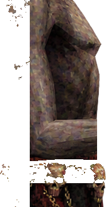

# 😈 ASMODEUS — Animated 2D Fighting Character

A side-view demon character (made from a single AI-generated image) cut into
**skeletal body parts** and animated with **procedural fighting moves** in pure
JavaScript. No game engine, no dependencies, no build step.



## What's inside

```
asmodeus/
├── index.html          ← open this! playable demo page
├── asmodeus.js         ← rig + animation engine (all moves live here)
├── asmodeus-rig.json   ← rig data (pivots/hierarchy) for porting to Godot/Unity
└── assets/             ← body parts cut from the original image
    ├── wing.png        (back layer)
    ├── torso.png       (chest + skull belt)
    ├── head.png        (horns + goat head + beard)
    ├── skirt.png       (cloth + banner, drawn in front of legs)
    ├── legs.png        (goat legs + hooves)
    ├── arm.png         (front forearm + gripping hand)
    └── staff.png       (orb staff — child of arm, swings with it)
```

## Moves included

| Move | Key | Description |
|------|-----|-------------|
| Idle | — | breathing, wing flap, cloth sway |
| Walk | `A` / `D` or `←`/`→` | leg cycle + body bob, auto-turns |
| Staff Strike | `J` | windup → slam with slash arc FX |
| Orb Cast | `K` | raises staff, charges glowing orb, fires projectile |
| Kick | `L` | rising kick with impact FX |
| Jump | `Space` | parabola jump, cloth lag, landing dust |
| Hit | `H` | knockback + red flash |
| Victory | button | staff raised, wings flapping, orb glow |

## Run it

Just open `index.html` in a browser — or serve the folder:

```bash
npx serve asmodeus   # or: python -m http.server
```

## Put it on GitHub

```bash
git init
git add asmodeus/
git commit -m "Add Asmodeus animated character"
git branch -M main
git remote add origin https://github.com/YOU/REPO.git
git push -u origin main
```

Then enable **Settings → Pages → Deploy from branch → main / (root)** and your
character demo is live at `https://YOU.github.io/REPO/` — perfect for syncing
with your game code.

## How to add / tweak a move

All moves are plain functions in the `MOVES` object in `asmodeus.js`:

```js
stomp: { loop: false, dur: 0.8, fn(t, s, P) {
  P.legs.rot  = kf(t, [[0,0], [0.3, 25], [1, 0]]);   // degrees, + = clockwise
  P.root.dy   = kf(t, [[0,0], [0.3, -40], [1, 0]]);  // px, negative = up
}, event: (t) => t >= 0.3 && t < 0.34 ? 'impact' : null },
```

- Pose keys: `root, torso, head, arm, staff, wing, skirt, legs`
- Each accepts `rot` (degrees), `dx`/`dy` (pixels)
- `kf(t, keyframes)` does smooth keyframe interpolation for you
- `event` triggers FX (see `onEvent()` to add your own effects)

## Using the rig in a game engine

`asmodeus-rig.json` describes each part's `pos` (sprite placement),
`pivot` (rotation joint) and `parent` (bone hierarchy) in the original
1024×1536 image space.

- **Godot**: create `Node2D`/`Sprite2D` per part, set `position = pos`,
  rotate around `pivot`, parent per the JSON. 
- **Unity**: same idea with `GameObject` + `SpriteRenderer`, pivot as child offset.
- **JS/canvas**: just reuse `asmodeus.js` — the `Rig` + `Part` classes are engine-free.

## Credits

- Character art: generated by the user (ChatGPT), name: **Asmodeus**
- Part cutting + rig + engine: built with Bionic
